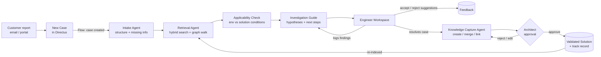
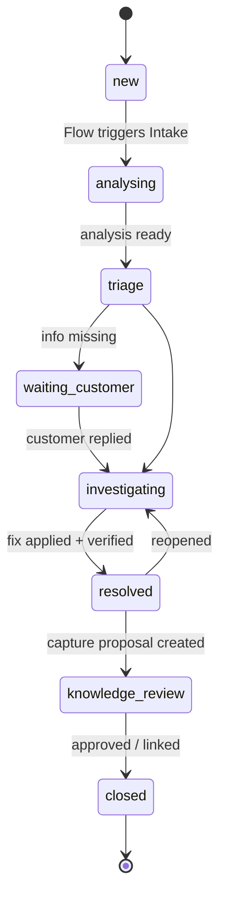
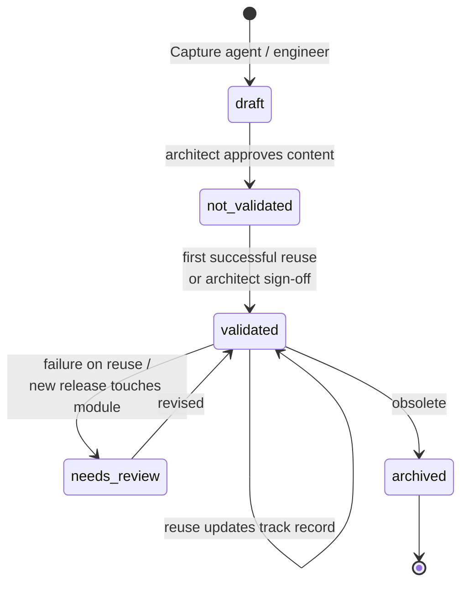
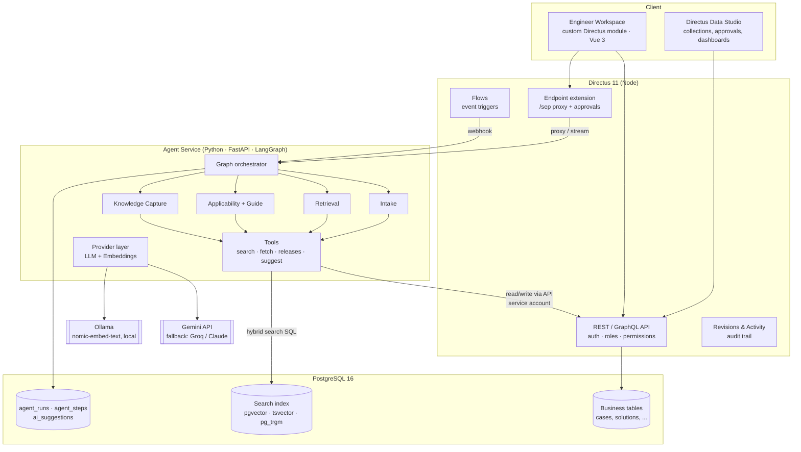
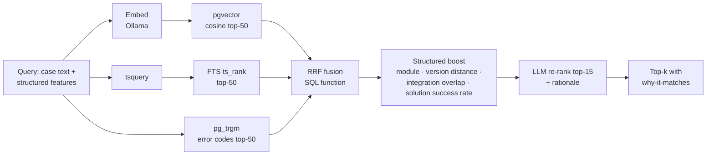
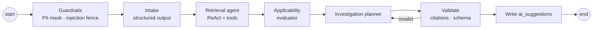
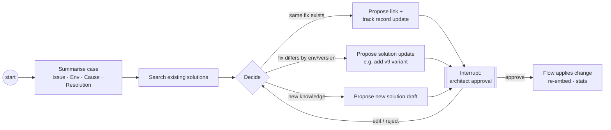
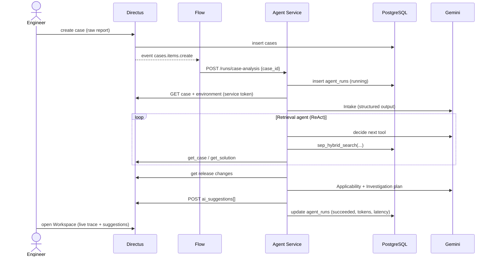
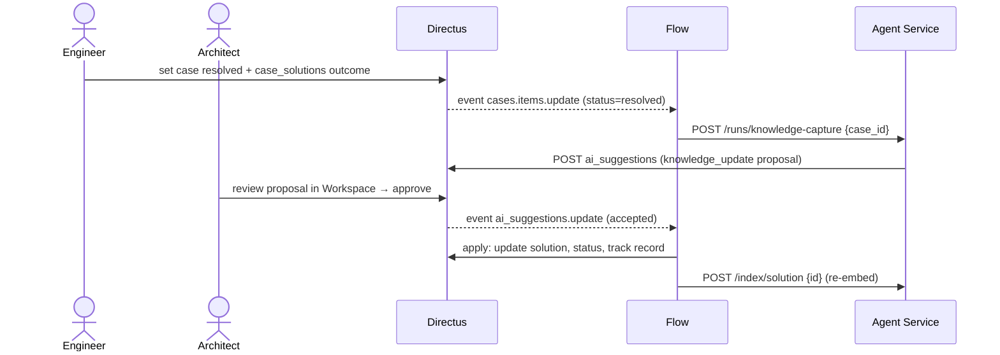

# 02 · Product & Implementation Document

**Project:** Solution Enablement Platform (SEP) for Viamedici
**Author:** Maithili · **Status:** Draft v0.1 · **Date:** 15 Oct 2026 · **Deadline:** 28 Oct 2026

> Research and the reasoning behind decisions D1–D11: see [01-research.md](01-research.md).

---

## 1. Product concept

### 1.1 One-liner
> **SEP turns every solved customer case into reusable, evidence-backed knowledge, and puts that knowledge in front of the engineer the moment a new case arrives.**

### 1.2 The problem in one picture
Today: *new case → engineer investigates from zero → fix → ticket closed → knowledge lost.*
With SEP: *new case → AI finds what we already know and whether it applies → engineer investigates with a head start → fix → knowledge captured and improved → next case is faster.*

### 1.3 Users

| Persona | Goal | What SEP gives them |
|---|---|---|
| **Support / Solution Engineer** | Solve the case quickly and correctly | Structured case, similar history, ranked hypotheses, next steps, ready-made customer questions |
| **Business Solution Architect** | Keep solution quality high, spot systemic issues | Approves knowledge, sees solution track records, recurring-problem clusters |
| **Knowledge reviewer** (can be the architect) | Keep the knowledge base clean | Merge proposals, stale/duplicate warnings |
| **Admin** | Run the platform | Directus admin, roles, agent run logs, cost/latency |

### 1.4 Product principles
1. **Engineer in control:** AI suggests, humans decide. No silent writes.
2. **Grounded or silent:** every AI claim cites a case or solution; "no relevant history" is a valid answer.
3. **Evidence over opinion:** solutions carry a track record (applied / succeeded / failed, per version).
4. **Environment matters:** similarity includes version, module and integration, not just text.
5. **Every case improves the base:** knowledge capture is part of closing a case, not an extra chore.
6. **Not another ticket tool:** we model the *knowledge loop*; the case is just where it starts.

### 1.5 How it maps to Case-Based Reasoning

| CBR step | SEP feature |
|---|---|
| Retrieve | Hybrid search + Retrieval agent |
| Reuse | Solution recommendations + Applicability check |
| Revise | Investigation workspace + Investigation Guide agent |
| Retain | Knowledge Capture agent + Architect approval |

---

## 2. User & workflow flows

### 2.1 End-to-end flow (the demo story)



### 2.2 Engineer journey (step by step)

1. **Case arrives.** The engineer opens it in the *Engineer Workspace*. Within seconds the analysis panel fills in, and the engineer can watch the agent's steps live (tools called, cases pulled, reasoning).
2. **Structured view.** The AI has extracted module, version, integration, symptoms and error codes. Missing information is flagged ("Which export profile? When was the last successful run?") with a **draft customer message**.
3. **Have we seen this before?** A ranked list of similar cases and solutions, each with *why it matches*, a *track record* and an *applicability verdict* (`applies` / `applies with changes` / `likely not applicable`, plus the reason).
4. **What should I check next?** Ranked hypotheses with concrete checks. The engineer records findings (`confirmed` / `ruled out` / `inconclusive`), and the guide **re-plans** after each one.
5. **Resolve.** The engineer marks which solution was applied and the outcome, or describes a new fix.
6. **Retain.** The Knowledge Capture agent proposes: *link to an existing solution*, *update an existing solution* (e.g. add the v9 variant), or *create a new solution*. The architect approves in one click.
7. **Loop closed.** The next similar case finds the new knowledge immediately.

### 2.3 Case lifecycle



### 2.4 Solution (knowledge) lifecycle, aligned with KCS



---

## 3. Functional scope & priorities

### Must have (complete CBR loop)
| ID | Feature |
|---|---|
| M1 | Data model in Directus/Postgres: customers, environments, releases, modules, integrations, cases, investigation steps, root causes, solutions, case↔solution outcomes, case links |
| M2 | Realistic synthetic dataset (~80 cases, ~25 solutions, ~12 customers, releases with breaking changes) incl. traps and recurring clusters |
| M3 | Hybrid search in PostgreSQL: FTS + pgvector + trigram, RRF fusion, structured boosts |
| M4 | **Intake agent:** raw report → structured fields, missing-info list |
| M5 | **Retrieval agent:** ReAct tool loop over search + relations, LLM re-rank with rationale |
| M6 | **Investigation Guide:** hypotheses, next checks, citations; re-plans on new findings |
| M7 | **Knowledge Capture agent:** create / merge / link proposal on resolve |
| M8 | Human approval: agents write `ai_suggestions` only; approval applies them |
| M9 | Directus Flows triggering agents on case create / resolve / solution approve |
| M10 | **Engineer Workspace** custom Directus module |
| M11 | One-command setup (`docker compose up`) + seed + bootstrap scripts |

### Should have (what makes it stand out)
| ID | Feature |
|---|---|
| S1 | **Live agent trace** shown live in the workspace (agent steps are written to Postgres and polled) |
| S2 | **Applicability check** using environment + release notes (breaking changes between versions) |
| S3 | Solution **track record** (applied / success / failure, per version) shown everywhere |
| S4 | Suggestion **feedback** (accept / reject / edit + reason) feeding ranking |
| S5 | **Customer clarification draft** from missing-info analysis |
| S6 | **Evaluation harness:** hit@k, MRR, ablation (hybrid vs vector vs FTS), LLM-as-judge for guidance quality |
| S7 | **Guardrails:** untrusted-input handling (prompt-injection defence), PII masking, citation validation, schema-validated outputs |
| S8 | **Observability:** `agent_runs` + `agent_steps` (tool calls, tokens, latency, errors) |
| S9 | "Ask the case" chat: free questions about the case grounded in history |

### Future / stretch
| ID | Feature |
|---|---|
| F1 | **Problem Management agent:** cluster recurring unsolved cases → propose ITIL Problem record |
| F2 | **Knowledge graph view** (case ↔ solution ↔ root cause ↔ module) |
| F3 | **Knowledge health:** flag solutions touched by a new release; detect duplicates |
| F4 | **Insights dashboard:** MTTR, reuse rate, knowledge coverage, AI acceptance rate |
| F5 | Tests + GitHub Actions CI |
| F6 | Production concerns: SSO, multi-tenant isolation, data residency, on-prem LLM option |

---

## 4. Architecture

### 4.1 Component view



### 4.2 Responsibilities

| Component | Responsibility | Why here |
|---|---|---|
| **PostgreSQL** | System of record + search engine (vectors, FTS, trigram, RRF function) | One database, transactional consistency between knowledge and its index; no extra vector DB to operate |
| **Directus** | Data model, API, auth/roles, Flows, admin UI, audit, Engineer Workspace host | Gives an enterprise-grade backend + admin for free; we spend our time on the knowledge loop |
| **Agent Service** | Agent graphs, tools, prompts, LLM/embedding providers, evaluation | Python has the strongest AI ecosystem; long-running LLM work does not belong in the Directus process |
| **Ollama** | Local embeddings | Free, private, no rate limits, fast enough on a laptop GPU |
| **Gemini API** | Reasoning / tool calling | Strong function calling on a free tier; swappable via provider interface |

### 4.3 Key architectural decisions

1. **Agents go through the Directus API with a service account** (not raw SQL) for all business reads/writes. They obey the same permissions and appear in the same audit trail as humans. *Exception:* hybrid search calls a read-only SQL function directly (Directus cannot express vector similarity).
2. **Agents write suggestions, not facts.** Only `ai_suggestions` and `agent_runs` are writable by the agent role. Applying a suggestion is a human action (or a Flow triggered by human approval).
3. **Event-driven via Directus Flows:** `cases.items.create` → analysis; `cases.status = resolved` → knowledge capture; `solutions` approved → re-embed. The UI also calls agents on demand through the endpoint extension.
4. **Provider abstraction:** `LLMProvider` / `EmbeddingProvider` interfaces; switching Gemini ↔ Groq ↔ Claude ↔ local is configuration.
5. **Search index separated from business tables:** `knowledge_chunks` holds text chunks + embeddings for cases and solutions, kept in sync by Flows. Business tables stay clean in Directus.

---

## 5. Data model (ERD)

```mermaid
erDiagram
    CUSTOMERS ||--o{ ENVIRONMENTS : operates
    ENVIRONMENTS }o--|| RELEASES : runs_version
    ENVIRONMENTS ||--o{ ENVIRONMENT_INTEGRATIONS : has
    INTEGRATIONS ||--o{ ENVIRONMENT_INTEGRATIONS : used_in
    ENVIRONMENTS ||--o{ ENVIRONMENT_MODULES : licenses
    MODULES ||--o{ ENVIRONMENT_MODULES : licensed_in
    RELEASES ||--o{ RELEASE_CHANGES : contains
    MODULES ||--o{ RELEASE_CHANGES : affects

    ENVIRONMENTS ||--o{ CASES : reported_in
    MODULES ||--o{ CASES : primary_module
    ROOT_CAUSES ||--o{ CASES : caused_by
    CASES ||--o{ INVESTIGATION_STEPS : investigated_by
    CASES ||--o{ CASE_SOLUTIONS : uses
    SOLUTIONS ||--o{ CASE_SOLUTIONS : applied_in
    CASES ||--o{ CASE_LINKS : from
    CASES ||--o{ CASE_LINKS : to
    ROOT_CAUSES ||--o{ SOLUTIONS : addresses
    SOLUTIONS ||--o{ SOLUTION_MODULES : applies_to
    MODULES ||--o{ SOLUTION_MODULES : covered_by
    SOLUTIONS ||--o{ SOLUTION_INTEGRATIONS : applies_to
    INTEGRATIONS ||--o{ SOLUTION_INTEGRATIONS : covered_by
    PROBLEMS ||--o{ CASES : groups

    CASES ||--o{ AGENT_RUNS : analysed_by
    AGENT_RUNS ||--o{ AGENT_STEPS : consists_of
    AGENT_RUNS ||--o{ AI_SUGGESTIONS : produces
    CASES ||--o{ AI_SUGGESTIONS : about

    CUSTOMERS {
        uuid id PK
        string name
        string industry
        string tier "standard|premium|strategic"
        string region
    }
    ENVIRONMENTS {
        uuid id PK
        uuid customer_id FK
        string name "PROD|QA|DEV"
        uuid release_id FK "current EPIM version"
        string deployment "on_prem|cloud"
        string database
        text config_notes
    }
    RELEASES {
        uuid id PK
        string version "e.g. 9.1.0"
        date release_date
        text summary
    }
    RELEASE_CHANGES {
        uuid id PK
        uuid release_id FK
        uuid module_id FK
        string change_type "feature|fix|breaking|deprecation"
        text description
    }
    MODULES {
        uuid id PK
        string code "EXPORT|IMPORT|CLASSIFICATION|..."
        string name
        text description
    }
    INTEGRATIONS {
        uuid id PK
        string name "SAP S/4HANA, Shopware 6, ..."
        string type "erp|webshop|marketplace|dam|print|pim_exchange"
    }
    ENVIRONMENT_INTEGRATIONS {
        uuid environment_id FK
        uuid integration_id FK
        string version
        text config_notes
    }
    ENVIRONMENT_MODULES {
        uuid environment_id FK
        uuid module_id FK
    }
    CASES {
        uuid id PK
        string case_number "CS-2025-0142"
        string title
        text customer_report "raw, untrusted"
        text customer_goal
        text symptoms
        text error_messages
        text steps_to_reproduce
        uuid environment_id FK
        uuid module_id FK
        uuid root_cause_id FK
        uuid problem_id FK
        string severity "S1..S4"
        string status "new..closed"
        string channel "email|portal|phone"
        json missing_info
        text resolution_summary
        uuid assigned_to FK "directus_users"
        timestamp opened_at
        timestamp resolved_at
    }
    INVESTIGATION_STEPS {
        uuid id PK
        uuid case_id FK
        int seq
        text action "what was checked"
        text finding
        string result "confirmed|ruled_out|inconclusive"
        string source "engineer|agent_suggested"
        uuid author FK
        timestamp created_at
    }
    ROOT_CAUSES {
        uuid id PK
        string code "CFG-EXPORT-FILTER"
        string category "configuration|data|product_bug|integration|infrastructure|upgrade|user_error"
        string name
        text description
    }
    SOLUTIONS {
        uuid id PK
        string solution_number "SOL-0031"
        string title
        text issue "KCS: customer words"
        text environment_conditions "KCS: where it applies"
        text cause "KCS"
        text resolution_steps "KCS"
        text verification_steps
        uuid root_cause_id FK
        string min_version
        string max_version
        string status "draft|not_validated|validated|needs_review|archived"
        int times_applied
        int times_successful
        boolean ai_generated
        uuid approved_by FK
        timestamp approved_at
        int revision
    }
    SOLUTION_MODULES {
        uuid solution_id FK
        uuid module_id FK
    }
    SOLUTION_INTEGRATIONS {
        uuid solution_id FK
        uuid integration_id FK
    }
    CASE_SOLUTIONS {
        uuid id PK
        uuid case_id FK
        uuid solution_id FK
        string relation "applied|referenced|derived_from"
        string outcome "resolved|partial|failed|not_tried"
        string version_at_apply
        text notes
        uuid applied_by FK
        timestamp applied_at
    }
    CASE_LINKS {
        uuid id PK
        uuid from_case_id FK
        uuid to_case_id FK
        string link_type "similar|duplicate|regression_of|same_problem"
        float confidence
        string created_by "engineer|agent"
    }
    PROBLEMS {
        uuid id PK
        string title
        text description
        string status "open|known_error|resolved"
        uuid root_cause_id FK
    }
    AGENT_RUNS {
        uuid id PK
        uuid case_id FK
        string graph "case_analysis|guide|knowledge_capture"
        string status "running|succeeded|failed"
        string model
        int tokens_in
        int tokens_out
        int latency_ms
        json error
        timestamp started_at
        timestamp finished_at
    }
    AGENT_STEPS {
        uuid id PK
        uuid run_id FK
        int seq
        string node "intake|retrieval|..."
        string type "thought|tool_call|tool_result|output"
        string tool_name
        json payload
        timestamp created_at
    }
    AI_SUGGESTIONS {
        uuid id PK
        uuid case_id FK
        uuid run_id FK
        string type "structure|similar_case|solution|next_step|clarification|knowledge_create|knowledge_update|case_link"
        json payload
        text rationale
        string confidence "high|medium|low"
        json citations "case/solution ids"
        string status "pending|accepted|rejected|edited|superseded"
        text feedback_note
        uuid decided_by FK
        timestamp decided_at
    }
```

**Search index (owned by the agent service, hidden in Directus):**

```sql
knowledge_chunks (
  id uuid PK,
  entity_type text,        -- 'case' | 'solution'
  entity_id uuid,
  chunk_type text,         -- 'symptoms' | 'resolution' | 'cause' | 'full'
  content text,
  embedding vector(768),   -- pgvector, HNSW index
  tsv tsvector,            -- GIN index, generated column
  metadata jsonb,          -- module, version, integrations, status, outcome stats
  updated_at timestamptz
)
```

### Why this model (defensible choices)
- **Case ≠ Solution (D1):** one solution can resolve many cases; a case can try several solutions. The **outcome lives on the relation** (D2), which is what makes "worked 7/8 times, failed on v9" possible.
- **Environment as structured data (D3):** customer → environment → release + modules + integrations. Applicability is computed, not guessed.
- **Release changes:** lets the agent reason *"fix verified on 8.x, but 9.0 has a breaking change in EXPORT"*.
- **Investigation steps (D4):** preserves the path, including ruled-out hypotheses, which the Guide uses ("in 3 similar cases, the export filter was checked first and ruled out").
- **Root-cause taxonomy:** a shared vocabulary for cases, solutions and problem clustering.
- **AI tables:** every AI output is traceable (`agent_runs` → `agent_steps`) and every suggestion has a human decision, which serves audit, trust and evaluation at once.

---

## 6. Search design



- `sep_hybrid_search(query_text, query_embedding, filters jsonb, k)` is one PostgreSQL function, testable on its own and usable from both the agent and the evaluation harness.
- RRF needs no score normalisation, so it is robust when combining very different scoring scales.
- Boosts are transparent and explainable (each candidate returns its score breakdown, shown in the UI).
- The evaluation harness compares variants: FTS-only, vector-only, hybrid, hybrid+boost, hybrid+boost+re-rank.

---

## 7. AI / agentic architecture

### 7.1 Design stance
A **graph-orchestrated workflow with agentic nodes** (research §7): deterministic steps where the path is known, a ReAct tool loop only where the path varies (retrieval, investigation planning), and **human interrupts** where responsibility lies with a person.

### 7.2 Graphs

**Graph A: Case Analysis** (trigger: case created, or "re-analyse")



**Graph B: Investigation Guide** (trigger: engineer logs a finding or asks a question)
Loads the case state + findings so far → updates hypothesis ranking (confirmed / ruled out) → proposes the next 1–3 checks → may call Retrieval again with new evidence (e.g. a newly found error code).

**Graph C: Knowledge Capture** (trigger: case resolved)



### 7.3 Agents and their tools

| Agent | Input | Output (schema-validated) | Tools |
|---|---|---|---|
| **Intake** | Raw report + known environment | Module, symptoms, error codes, goal, severity hint, `missing_info[]`, clarification draft | `get_environment` |
| **Retrieval** | Structured case | Ranked candidates with `why_it_matches`, score breakdown | `hybrid_search`, `get_case`, `get_solution`, `get_related_cases`, `get_solution_track_record` |
| **Applicability** | Candidate solutions + environment | Verdict per solution: `applies` / `applies_with_changes` / `not_applicable` + reason | `get_release_changes(from, to, module)`, `compare_environments` |
| **Investigation Guide** | Case + candidates + findings | Hypotheses (ranked, with evidence), next checks, citations | `get_investigation_steps`, `hybrid_search`, `get_case` |
| **Knowledge Capture** | Resolved case | Create / update / link proposal with diff | `hybrid_search(solutions)`, `get_solution` |

All tool calls are logged to `agent_steps` and streamed to the Workspace (S1).

### 7.4 Why this agent architecture is useful (answering the brief)
- **Retrieval is genuinely iterative.** An engineer searching history reformulates, filters by module, opens a hit, follows it to its solution and to other cases using that solution. A single vector query cannot do this; a tool loop can.
- **Applicability is the expensive human judgement** ("is the previous solution relevant?"). Automating the first pass with release-change data saves the most investigation time.
- **The Guide makes history actionable**: it does not just list cases, it turns them into the next concrete check, and adapts as findings come in.
- **Capture removes the biggest KCS failure mode**: engineers not writing knowledge after closing a case. A drafted, de-duplicated proposal makes retaining knowledge a one-click review.

### 7.5 Guardrails & quality
- **Untrusted input:** customer text is wrapped and labelled as data; the system prompt instructs the agents to never follow instructions found inside it; tools have least-privilege permissions (agents cannot write cases/solutions directly).
- **PII masking** (emails, phone numbers, names) before LLM calls.
- **Structured outputs** (Pydantic schemas) with retry on validation failure.
- **Citation validation:** cited IDs must be in the retrieved set; otherwise the step is re-run or the claim is dropped.
- **Abstention:** explicit "no sufficiently similar history" result below a similarity threshold.
- **Resilience:** retry with backoff on rate limits; fallback provider.

---

## 8. System flows (sequence)

### 8.1 New case → analysis



### 8.2 Resolve → knowledge



---

## 9. Technology decisions

| Area | Choice | Alternatives considered | Reason |
|---|---|---|---|
| Backend platform | **Directus 11** (mandatory) | n/a | Instant API, roles, Flows, admin, audit on top of our own Postgres schema |
| Database | **PostgreSQL 16 + pgvector + pg_trgm** (mandatory) | Separate vector DB (Qdrant, Pinecone) | One system for relational, FTS and vector data; transactional sync; simpler ops |
| Agent runtime | **Python 3.12 · FastAPI · LangGraph** | Plain function-calling loop; CrewAI; Directus TS extension | Explicit state graphs, interrupts for approval, checkpoints; Python AI ecosystem; graph is easy to diagram and explain |
| LLM | **Gemini (Flash) via free tier**, behind provider interface | Claude, GPT, local 7B via Ollama | Good tool calling and long context at zero cost; local 7B models are unreliable at multi-step tool use on 6 GB VRAM |
| Embeddings | **nomic-embed-text via Ollama (local)** | Gemini / OpenAI / Voyage embeddings | Free, private, no rate limits, good retrieval quality, 768-dim |
| Engineer UI | **Custom Directus module (Vue 3)** | Separate Next.js app | Reuses Directus auth/permissions; shows deep Directus usage; less glue code |
| Live trace | **Polling `agent_steps`** every 1.5 s while a run is active | SSE, WebSockets | Each agent step is already a row in Postgres (audit trail), so polling it is simple, survives restarts and needs no extra infrastructure |
| Packaging | **Docker Compose** | Manual installs | One-command reproducible setup for reviewers |
| Validation | **Pydantic v2** | JSON schema by hand | Typed LLM outputs, automatic retries |
| Testing | **pytest** + eval harness | n/a | Unit tests for tools/search; offline metrics for retrieval |

---

## 10. Security & roles

| Role | Permissions |
|---|---|
| **Engineer** | CRUD own cases & investigation steps; read solutions; accept/reject suggestions on own cases |
| **Solution Architect** | Everything Engineer can + approve/edit solutions, approve knowledge proposals, manage root causes |
| **Agent (service account)** | Read business data; create `ai_suggestions`, `agent_runs`, `agent_steps`; **no** direct write on cases/solutions |
| **Admin** | Full |

Secrets live in `.env` (gitignored). Customer text is untrusted input (see §7.5).

---

## 11. Dataset strategy

1. **Taxonomy first:** modules (~10), integrations (~12), root causes (~25 across 7 categories), releases 8.0 → 9.2 with realistic breaking changes.
2. **Scenario matrix:** module × root cause × version × integration → pick ~25 *solution patterns* that are realistic for a PIM.
3. **Generate cases from patterns** (LLM-assisted, seeded, then reviewed): 2–5 cases per pattern, written in varied customer language, with investigation steps (including ruled-out paths), outcomes and dates spread over ~2 years.
4. **Deliberate traps:**
   - *Version trap:* fix works on 8.x, fails on 9.x (breaking change)
   - *Near-duplicates:* same symptom, different root cause
   - *Red herrings:* misleading error messages
   - *Recurring cluster:* several unsolved cases sharing one hidden problem (for F1)
   - *Failed attempts:* `case_solutions` with `outcome = failed`
5. **Validation script:** referential integrity, distribution checks, every solution has ≥1 case, held-out split.
6. **Held-out set:** ~15 cases with known "correct" solutions, excluded from the index during evaluation.

All data is fictional; customer names are invented.

---

## 12. Evaluation plan

| What | Metric | How |
|---|---|---|
| Retrieval quality | **hit@1, hit@5, MRR** | Held-out cases → does the known correct solution appear in top-k? |
| Search design | **Ablation** | FTS-only vs vector-only vs hybrid vs hybrid+boost vs +LLM re-rank |
| Applicability | Accuracy on trap cases | Does the agent flag the version trap correctly? |
| Guidance quality | LLM-as-judge (rubric) + manual spot check | Relevance, correctness, groundedness, actionability |
| Groundedness | % claims with valid citations | Citation validator logs |
| Ops | Latency p50/p95, tokens per run | `agent_runs` |
| Adoption (future, real usage) | Acceptance rate, MTTR, reuse rate | `ai_suggestions` decisions, case timestamps |

Results go into the technical documentation and the presentation.

---

## 13. Implementation plan (15 → 28 Oct)

| Day | Date | Deliverable |
|---|---|---|
| 1 | Wed 15 | Research doc, this design doc, repo + env setup |
| 2 | Thu 16 | Docker Compose (Postgres+pgvector, Directus, Ollama link); schema as SQL migrations; Directus collections/relations/roles via bootstrap script |
| 3 | Fri 17 | Taxonomy + releases; dataset generator; seed ~80 cases / ~25 solutions; validation script |
| 4 | Sat 18 | `knowledge_chunks`, embedding pipeline, `sep_hybrid_search` SQL; first retrieval eval (FTS vs vector vs hybrid) |
| 5 | Sun 19 | Agent service skeleton: providers, Directus client, run/step logging, guardrails; Intake agent |
| 6 | Mon 20 | Retrieval agent (ReAct) + re-rank; Applicability evaluator |
| 7 | Tue 21 | Investigation Guide (Graph B); Knowledge Capture (Graph C) with approval interrupt |
| 8 | Wed 22 | Directus Flows wiring + endpoint extension (proxy + suggestion approval) |
| 9 | Thu 23 | Engineer Workspace module: case view, analysis panel, live trace, suggestions with accept/reject |
| 10 | Fri 24 | Workspace: investigation log, resolve & knowledge review; end-to-end demo path working |
| 11 | Sat 25 | Evaluation harness + ablation results; guardrail tests; fixes |
| 12 | Sun 26 | Stretch: Problem Management agent, insights dashboard, graph view (as far as time allows); pytest + CI |
| 13 | Mon 27 | Technical documentation, README, diagrams exported, slides, demo script, backup recording |
| 14 | Tue 28 | Buffer, final rehearsal, **submit** |

**Milestones:** M-A (day 4) searchable dataset · M-B (day 8) agents working end-to-end via API · M-C (day 10) full demo in UI · M-D (day 13) submission package.

---

## 14. Risks & mitigations

| Risk | Impact | Mitigation |
|---|---|---|
| Free-tier rate limits / outages on demo day | Demo fails | Provider abstraction + Groq fallback; cache analysis results; recorded backup demo |
| Synthetic data feels fake | Weak credibility | Domain research (§8 research), traps, real investigation paths, manual review |
| Directus extension learning curve | UI delay | Start with Data Studio views; module built on days 9–10 with SDK; keep UI focused on one screen |
| LLM output inconsistency | Broken UI / wrong claims | Pydantic schemas, retries, citation validation, abstention |
| Scope creep | Unfinished core | Must-haves first; stretch only after milestone M-C |
| Windows/Docker setup issues | Lost day | Set up Docker on day 1–2; document setup steps |

---

## 15. Assumptions & open questions

- **Assumption:** cases arrive already associated with a customer environment (as in a real support portal). Intake can still correct or complete it.
- **Assumption:** English-language cases for the prototype; the embedding model and design support multilingual later (relevant for a German vendor).
- **Assumption:** a single Viamedici product line (EPIM) with modules; multi-product is a future extension.
- **Open (for Viamedici):** Which channels do cases really arrive through? Is there an existing KB to import? What is the on-prem / data-residency requirement for LLM usage? This drives the provider choice in production.
