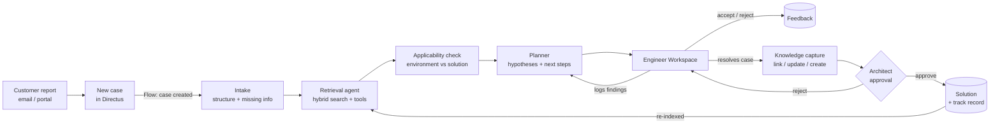
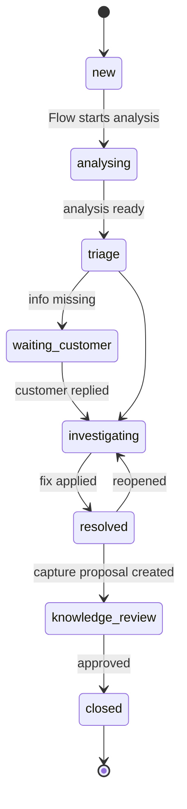
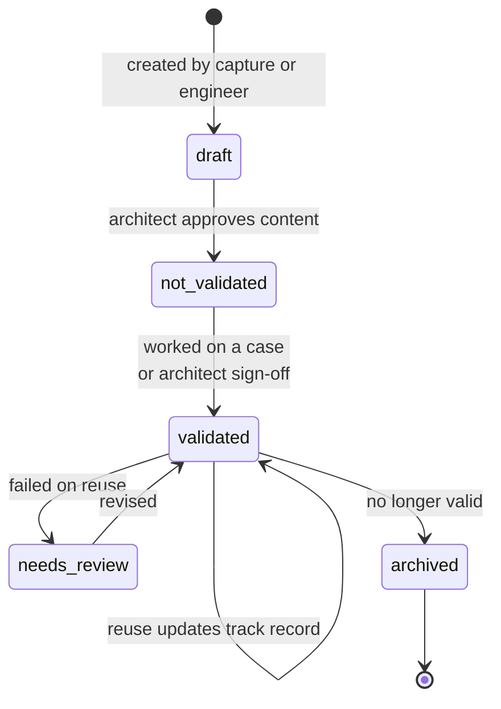
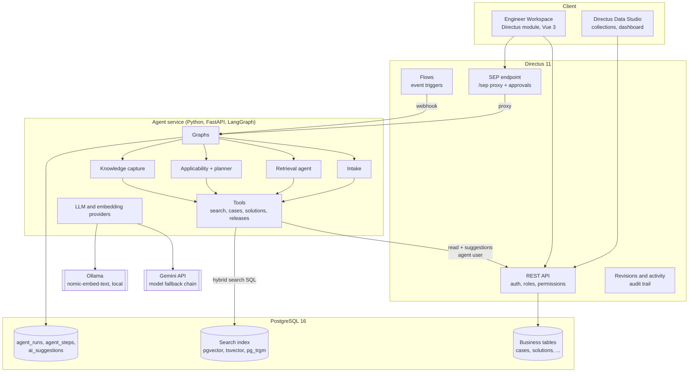
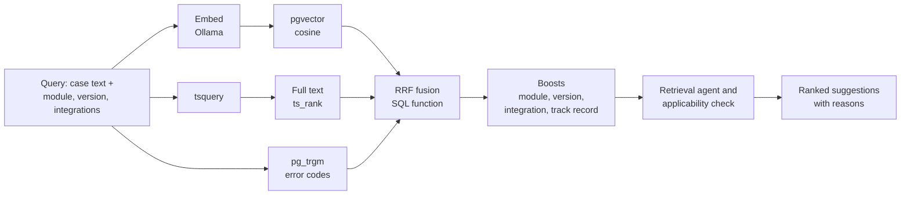
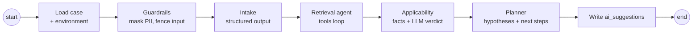
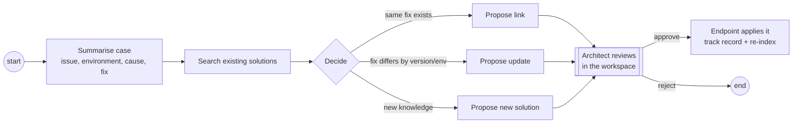
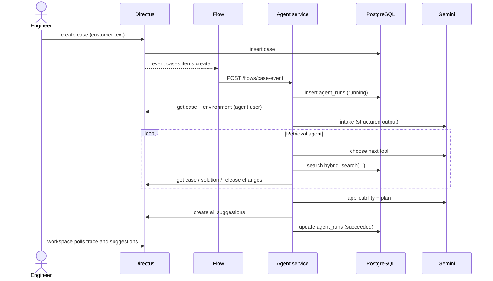
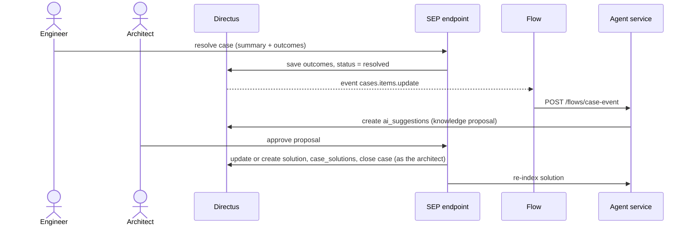

# 02 Product & Implementation

**Project:** Solution Enablement Platform (SEP) for Viamedici
**Author:** Maithili
**Date:** October 2026

The research behind this and decisions D1 to D11 are in [01-research.md](01-research.md). How the code works in detail is in [03-technical.md](03-technical.md).

## 1. Product idea

### 1.1 In one sentence

SEP keeps the knowledge from solved customer cases and shows it to the engineer as soon as a new case comes in, together with whether the old fix still applies.

### 1.2 Before and after

Today: new case, the engineer starts from zero, finds a fix, closes the ticket, and the knowledge is mostly lost.

With SEP: new case, the AI finds what we already know and checks if it fits this customer, the engineer starts with a head start, and after the fix the knowledge is saved and the next case is faster.

### 1.3 Users

| User | Wants to | What SEP gives them |
|---|---|---|
| Support / solution engineer | Solve the case fast and correctly | Structured case, similar cases and solutions, hypotheses, next steps, questions for the customer |
| Solution architect | Keep solutions correct, see bigger issues | Approves knowledge, sees track records, sees groups of related open cases |
| Admin | Run the platform | Directus admin, roles, logs of every agent run |

### 1.4 Rules I followed

1. The engineer decides. The AI only suggests and never changes data on its own.
2. Every AI claim points to a case or solution. "Nothing relevant found" is a valid answer.
3. Solutions show how often they worked and failed, per version.
4. Similarity looks at version, module and integrations, not only text.
5. Saving knowledge is part of closing a case, not extra work later.
6. It isn't another ticket tool. The focus is the knowledge loop, and the case is where it starts.

### 1.5 Mapping to case-based reasoning

| Step | In SEP |
|---|---|
| Retrieve | Hybrid search and the retrieval agent |
| Reuse | Solution suggestions with an applicability verdict |
| Revise | Investigation log and next-step suggestions |
| Retain | Knowledge capture and architect approval |

## 2. Flows

### 2.1 Main flow



### 2.2 What the engineer does

1. **A case comes in.** The engineer opens it in the Engineer Workspace. While the agents run, each step shows up in a live trace (which tools were called, what was found).
2. **Structured case.** The AI fills in module, integrations, symptoms and error codes. It lists missing information (for example "when did the last export work?") and drafts a message to the customer.
3. **Have we seen this before?** A ranked list of solutions and similar cases. Each one shows why it matches, its track record and a verdict: applies, applies with changes, or not applicable, with the reason.
4. **What do I check next?** Hypotheses and next steps. The engineer logs findings as confirmed, ruled out or inconclusive and can ask for new next steps based on them.
5. **Resolve.** The engineer writes what fixed it and marks which solution was used.
6. **Save the knowledge.** The capture agent proposes to link the case to an existing solution, update a solution (for example add the 9.x variant), or create a new one. The architect checks and approves it.
7. **Done.** The next similar case finds this knowledge straight away.

### 2.3 Case status



### 2.4 Solution status (KCS)



## 3. Scope

### Must have (all built)

| ID | Feature |
|---|---|
| M1 | Data model in PostgreSQL, managed in Directus: customers, environments, releases, modules, integrations, cases, investigation steps, root causes, solutions, case-solution outcomes, case links |
| M2 | Sample dataset: 78 cases, 27 solutions, 12 customers, releases 8.0 to 9.2 with breaking changes, with traps and a group of related open cases |
| M3 | Hybrid search in PostgreSQL: full text, pgvector and trigram, merged with RRF, boosted by module, version, integration and track record |
| M4 | Intake: customer text to structured fields and missing information |
| M5 | Retrieval agent: tool loop over search, cases, solutions, customer history and release notes |
| M6 | Planner: hypotheses and next steps with sources, re-planned from the investigation log |
| M7 | Knowledge capture on resolve: link, update or create |
| M8 | Human approval: agents only write `ai_suggestions`, a person applies them |
| M9 | Directus Flows start the agents on case create and update |
| M10 | Engineer Workspace as a custom Directus module |
| M11 | Setup with Docker Compose and one setup command |

### Should have

| ID | Feature | Status |
|---|---|---|
| S1 | Live agent trace in the workspace | Built (polling `agent_steps`) |
| S2 | Applicability check with release changes between versions | Built |
| S3 | Track record per solution and per major version | Built |
| S4 | Accept / reject with a note on every suggestion | Built (stored, not yet used for ranking) |
| S5 | Draft message to the customer for missing info | Built |
| S6 | Retrieval evaluation on held-out cases | Held-out set ready, evaluation script not done |
| S7 | Guardrails: prompt injection handling, masking e-mails and phone numbers, citation check, validated outputs | Built |
| S8 | Logging of runs and steps (tool calls, tokens, time, errors) | Built |
| S9 | "Ask about this case" | Built |

### Extra / later

| ID | Feature | Status |
|---|---|---|
| F1 | Problem detection: group related open cases and propose an ITIL problem | Built |
| F2 | Graph view of cases, solutions and causes | Not built |
| F3 | Flag solutions affected by a new release, find duplicates | Not built |
| F4 | Insights dashboard | Basic Directus dashboard built |
| F5 | Tests and CI | Not built |
| F6 | Production topics: SSO, data residency, on-prem LLM | Not built |

## 4. Architecture

### 4.1 Components



### 4.2 What each part does

| Part | Job | Why |
|---|---|---|
| PostgreSQL | Stores all data and is also the search engine (vectors, full text, trigram, RRF function) | One database, so the data and its index stay in sync and there's no separate vector database to run |
| Directus | Data model, API, login and roles, Flows, admin UI, audit trail, hosts the Engineer Workspace | Gives the backend and admin parts out of the box, so I could spend the time on the knowledge loop |
| Agent service | Agent graphs, tools, prompts, LLM and embedding calls, indexing | Python has the best AI libraries, and long LLM calls shouldn't run inside Directus |
| Ollama | Embeddings on the local machine | Free, private, no rate limits |
| Gemini | Reasoning and tool calling | Good tool calling on the free tier, and can be swapped through the provider layer |

### 4.3 Main decisions

1. **Agents read business data through the Directus API** with their own user, so they follow the same permissions and show up in the same audit trail as people. The exceptions are hybrid search, which calls a SQL function directly because Directus can't do vector search, and the run and step logging.
2. **Agents write suggestions, not data.** The agent role can only read, create suggestions and change the case status. Applying a suggestion is done by a person, with that person's permissions.
3. **Flows start the work:** creating a case starts the analysis, and setting it to resolved starts knowledge capture. The workspace can also start runs directly through the SEP endpoint.
4. **Provider layer:** the LLM and embedding providers sit behind one interface, so switching models is a config change.
5. **The search index is separate** from the business tables, in its own `search` schema, so Directus doesn't show it and it can be rebuilt any time.

## 5. Data model (ERD)

```mermaid
erDiagram
    CUSTOMERS ||--o{ ENVIRONMENTS : operates
    ENVIRONMENTS }o--|| RELEASES : runs_version
    ENVIRONMENTS ||--o{ ENVIRONMENT_INTEGRATIONS : has
    INTEGRATIONS ||--o{ ENVIRONMENT_INTEGRATIONS : used_in
    ENVIRONMENTS ||--o{ ENVIRONMENT_MODULES : licenses
    MODULES ||--o{ ENVIRONMENT_MODULES : licensed_in
    RELEASES ||--o{ RELEASE_CHANGES : contains
    MODULES ||--o{ RELEASE_CHANGES : affects

    ENVIRONMENTS ||--o{ CASES : reported_in
    MODULES ||--o{ CASES : primary_module
    ROOT_CAUSES ||--o{ CASES : caused_by
    CASES ||--o{ INVESTIGATION_STEPS : investigated_by
    CASES ||--o{ CASE_SOLUTIONS : uses
    SOLUTIONS ||--o{ CASE_SOLUTIONS : applied_in
    CASES ||--o{ CASE_LINKS : from
    CASES ||--o{ CASE_LINKS : to
    ROOT_CAUSES ||--o{ SOLUTIONS : addresses
    SOLUTIONS ||--o{ SOLUTION_MODULES : applies_to
    MODULES ||--o{ SOLUTION_MODULES : covered_by
    SOLUTIONS ||--o{ SOLUTION_INTEGRATIONS : applies_to
    INTEGRATIONS ||--o{ SOLUTION_INTEGRATIONS : covered_by
    PROBLEMS ||--o{ CASES : groups

    CASES ||--o{ AGENT_RUNS : analysed_by
    AGENT_RUNS ||--o{ AGENT_STEPS : consists_of
    AGENT_RUNS ||--o{ AI_SUGGESTIONS : produces
    CASES ||--o{ AI_SUGGESTIONS : about

    CUSTOMERS {
        uuid id PK
        string name
        string industry
        string tier "standard|premium|strategic"
        string region
    }
    ENVIRONMENTS {
        uuid id PK
        uuid customer_id FK
        string name "PROD|QA|DEV"
        uuid release_id FK "current EPIM version"
        string deployment "on_prem|cloud"
        string database
        text config_notes
    }
    RELEASES {
        uuid id PK
        string version "e.g. 9.1"
        int version_major
        int version_minor
        date release_date
        text summary
    }
    RELEASE_CHANGES {
        uuid id PK
        uuid release_id FK
        uuid module_id FK
        string change_type "feature|fix|breaking|deprecation"
        string title
        text description
    }
    MODULES {
        uuid id PK
        string code "EXPORT|IMPORT|WORKFLOW|..."
        string name
        text description
    }
    INTEGRATIONS {
        uuid id PK
        string code
        string name "SAP S/4HANA, Shopware 6, ..."
        string type "erp|webshop|marketplace|dam|print|translation|data_exchange"
    }
    ENVIRONMENT_INTEGRATIONS {
        uuid environment_id FK
        uuid integration_id FK
        string version
        text config_notes
    }
    ENVIRONMENT_MODULES {
        uuid environment_id FK
        uuid module_id FK
    }
    CASES {
        uuid id PK
        string case_number
        string title
        text customer_report "raw, untrusted"
        text customer_goal
        text symptoms
        text error_messages
        text steps_to_reproduce
        uuid environment_id FK
        string epim_version "version at the time"
        uuid module_id FK
        uuid root_cause_id FK
        uuid problem_id FK
        string severity "S1..S4"
        string status "new..closed"
        string channel "email|portal|phone"
        json missing_info
        text resolution_summary
        uuid assigned_to FK "directus_users"
    }
    INVESTIGATION_STEPS {
        uuid id PK
        uuid case_id FK
        int seq
        text action "what was checked"
        text finding
        string result "confirmed|ruled_out|inconclusive"
        string source "engineer|agent_suggested"
        uuid author FK
        timestamp created_at
    }
    ROOT_CAUSES {
        uuid id PK
        string code
        string category "configuration|data|product_bug|integration|..."
        string name
        text description
    }
    SOLUTIONS {
        uuid id PK
        string solution_number "SOL-016"
        string title
        text issue "KCS"
        text environment_conditions "KCS"
        text cause "KCS"
        text resolution_steps "KCS"
        text verification_steps
        uuid root_cause_id FK
        string min_version
        string max_version
        string status "draft|not_validated|validated|needs_review|archived"
        int times_applied "trigger"
        int times_successful "trigger"
        int times_failed "trigger"
        boolean ai_generated
        uuid approved_by FK
        timestamp approved_at
        int revision
    }
    SOLUTION_MODULES {
        uuid solution_id FK
        uuid module_id FK
    }
    SOLUTION_INTEGRATIONS {
        uuid solution_id FK
        uuid integration_id FK
    }
    CASE_SOLUTIONS {
        uuid id PK
        uuid case_id FK
        uuid solution_id FK
        string relation "applied|referenced|derived_from"
        string outcome "resolved|partial|failed|not_tried"
        string version_at_apply
        text notes
        uuid applied_by FK
        timestamp applied_at
    }
    CASE_LINKS {
        uuid id PK
        uuid from_case_id FK
        uuid to_case_id FK
        string link_type "similar|duplicate|regression_of|same_problem"
        float confidence
        string created_by "engineer|agent"
    }
    PROBLEMS {
        uuid id PK
        string title
        text description
        string status "proposed|open|known_error|resolved|rejected"
        uuid root_cause_id FK
        boolean ai_generated
    }
    AGENT_RUNS {
        uuid id PK
        uuid case_id FK
        string graph "case_analysis|investigation_guide|knowledge_capture|ask_case|problem_detection"
        string status "running|succeeded|failed"
        string trigger "flow|manual|eval"
        string model
        int tokens_in
        int tokens_out
        int latency_ms
        text error
        timestamp started_at
        timestamp finished_at
    }
    AGENT_STEPS {
        uuid id PK
        uuid run_id FK
        int seq
        string node "intake|retrieval|..."
        string type "node_start|thought|tool_call|tool_result|output|error|guardrail"
        string tool_name
        text summary
        json payload
        timestamp created_at
    }
    AI_SUGGESTIONS {
        uuid id PK
        uuid case_id FK
        uuid run_id FK
        string type "case_structure|solution|hypothesis|next_step|clarification|knowledge_*|problem|..."
        string title
        json payload
        text rationale
        string confidence "high|medium|low"
        int rank
        json citations
        string status "pending|accepted|rejected|edited|superseded"
        text feedback_note
        uuid decided_by FK
        timestamp decided_at
    }
```

**Search index** (schema `search`, not shown in Directus):

```sql
search.knowledge_chunks (
  id          uuid PK,
  entity_type text,          -- 'case' | 'solution'
  entity_id   uuid,
  chunk_type  text,          -- 'problem' | 'resolution' | 'issue' | 'fix'
  content     text,
  codes       text,          -- error codes, trigram index
  embedding   vector(768),   -- HNSW index
  tsv         tsvector,      -- generated, GIN index
  metadata    jsonb,         -- modules, integrations, version, track record
  updated_at  timestamptz
)
```

### Why the model looks like this

- **Cases and solutions are separate (D1).** One solution can fix many cases, and one case can try several solutions. The outcome is stored on `case_solutions` (D2), which is what makes "worked 7 of 8 times, failed on 9.x" possible. A trigger keeps the counts on the solution up to date.
- **The environment is structured (D3):** customer, environment, release, modules and integrations. Applicability can be checked from data instead of guessed.
- **Release changes** let the agent see things like "this fix was proven on 8.x, but 9.0 has a breaking change in the export module".
- **Investigation steps (D4)** keep the path, including what was ruled out.
- **Root causes** give cases, solutions and problems a shared list of causes.
- **AI tables:** every run can be traced (`agent_runs`, `agent_steps`), and every suggestion has a human decision. This helps with audit, trust and later evaluation.

## 6. Search design



- `search.hybrid_search(...)` is one PostgreSQL function, used by the agents and by the search box in the workspace.
- RRF works on ranks, not scores, so the three very different scores don't need to be normalised.
- Each result comes with a breakdown (rank per method and each boost), so it's clear why something matched.

## 7. AI agents

### 7.1 Approach

A fixed LangGraph workflow, with one tool-using agent only in the step where the path really varies (retrieval). The engineer approves everything that changes data (research section 7).

### 7.2 Graphs

**Case analysis** (when a case is created, or on "re-analyse")



**Investigation guide** (button "Suggest next steps"): reads the investigation log, searches again with what was found and suggests new next steps.

**Knowledge capture** (when the case is set to resolved)



**Problem detection** (nightly Flow or the Problems page): groups open cases without a solution by embedding similarity, and the LLM decides whether a group shares a cause and proposes a problem record.

**Ask** ("Ask about this case"): answers a question using search and the case history, with sources.

### 7.3 Steps and tools

| Step | Input | Output | Tools |
|---|---|---|---|
| Intake | Customer text and environment | Module, integrations, symptoms, error codes, goal, severity, missing info, message to customer | none |
| Retrieval agent | Structured case | Ranked cases and solutions with reasons | `search_knowledge`, `get_case`, `get_solution`, `get_customer_history`, `get_release_changes` |
| Applicability | Candidate solutions and environment | Verdict per solution with reason | Code collects version range, module and integration overlap, track record, release changes, history at this customer |
| Planner | Case, candidates, findings | Hypotheses, next steps, sources | none |
| Knowledge capture | Resolved case | Link, update or create proposal | hybrid search over solutions |

Every tool call and result is saved in `agent_steps` and shown in the workspace trace.

### 7.4 Why agents help here

- **Searching history takes more than one query.** An engineer rephrases, filters by module, opens a result and follows it to its solution and to other cases. A tool loop can do this, a single vector search can't.
- **Checking applicability takes the most judgement.** Whether an old fix still applies after an upgrade is where most time goes, and the release notes make a first check possible.
- **The planner turns history into a next step** instead of just a list of cases.
- **Capture fixes the usual KCS problem:** people don't write knowledge after closing a case. A ready draft that only needs approval makes it much more likely to happen.

### 7.5 Guardrails

- Customer text is treated as data. It's fenced in the prompt, and common prompt-injection patterns are detected and logged.
- E-mail addresses and phone numbers are masked before anything goes to the LLM.
- Outputs are checked against Pydantic schemas and retried with the error if invalid.
- Only case and solution numbers that were actually retrieved in the run can be cited. Anything else is dropped.
- "No fitting solution" is allowed.
- If a model is overloaded, the next model in the chain is used. If the retrieval agent fails, plain hybrid search results are used.

## 8. Sequence diagrams

### 8.1 New case to analysis



### 8.2 Resolve to knowledge



## 9. Technology choices

| Area | Choice | Other options | Why |
|---|---|---|---|
| Backend | Directus 11 (required) | | API, roles, Flows, admin and audit on top of my own schema. I used 11 instead of 12 because 12 without a licence limits users and field permissions |
| Database | PostgreSQL 16 with pgvector and pg_trgm (required) | Separate vector database (Qdrant, Pinecone) | Relational data, full text and vectors in one place, always in sync |
| Agents | Python 3.12, FastAPI, LangGraph | Plain tool-calling loop, CrewAI, Directus TypeScript extension | Clear step graph that's easy to draw and explain, good Python AI libraries |
| LLM | Gemini Flash models on the free tier, behind a provider interface | Claude, GPT, local models with Ollama | Good tool calling for free. Small local models were unreliable at multi-step tool use on my 6 GB GPU |
| Embeddings | nomic-embed-text with Ollama | Gemini, OpenAI, Voyage embeddings | Free, local, no rate limits, 768 dimensions |
| Engineer UI | Custom Directus module (Vue 3) | Separate Next.js app | Uses Directus login and permissions, less glue code |
| Live trace | Polling `agent_steps` every 1.5 s | SSE, WebSockets | Steps are already rows in Postgres, so polling is simple and survives restarts |
| Setup | Docker Compose | Manual installs | Same setup on every machine |
| Validation | Pydantic v2 | Hand-written JSON schema | Typed LLM output and retries |

## 10. Roles

| Role | Can do |
|---|---|
| Support engineer | Create and work on cases and investigation steps, read solutions, accept or reject suggestions |
| Solution architect | Everything the engineer can, plus edit and approve solutions and knowledge proposals |
| AI agent (service user) | Read business data, create suggestions, runs and steps, change case status. No direct writes to cases or solutions |
| Admin | Everything |

Secrets are in `.env`, which isn't committed. Customer text is untrusted (see 7.5).

## 11. Dataset

1. **Taxonomy first:** 12 modules, 13 integrations, root causes in several categories, releases 8.0 to 9.2 with breaking changes, 12 customers with their environments.
2. **Solution patterns:** realistic PIM problems (module, cause, version, integration), giving 27 solutions.
3. **Cases per solution:** a few cases each, written in different customer wording, with investigation steps (including dead ends), outcomes and dates over about two years. I generated them with LLM help and then went through them by hand.
4. **Traps on purpose:**
   - a fix that works on 8.x and fails on 9.x
   - the same symptom with different causes
   - misleading error codes that look alike
   - five open 9.2 cases with one hidden shared cause (for problem detection)
   - solutions that were tried and failed
5. **Held out:** 18 cases are kept aside in `eval/holdout.json` for testing retrieval.

All companies and people in the data are made up.

## 12. Evaluation

| What | Measure | How | Status |
|---|---|---|---|
| Retrieval | hit@1, hit@5, MRR | Does the right solution show up for the held-out cases? | Set prepared, not run yet |
| Search design | Comparison | Full text only vs vector only vs hybrid vs hybrid with boosts | Not run yet |
| Applicability | Trap cases | Does the agent catch the version trap? | Checked by hand with the demo cases |
| Groundedness | Citations | Invalid citations are logged by the validator | Built |
| Running cost | Time and tokens per run | `agent_runs` | Built |
| Real use (later) | Acceptance rate, time to resolve, reuse rate | Suggestion decisions and case dates | Data is collected |

## 13. Plan (15 to 28 October)

| Days | What |
|---|---|
| 15 Oct | Research, this design document, repository |
| 16 to 18 Oct | Docker Compose, schema, Directus bootstrap, dataset and seed, search index and hybrid search |
| 19 to 22 Oct | Agent service, intake, retrieval agent, applicability, planner, knowledge capture, Flows and SEP endpoint |
| 23 to 25 Oct | Engineer Workspace: case view, live trace, suggestions, investigation log, resolve and review |
| 26 to 27 Oct | Problem detection, ask, fixes, technical documentation, README |
| 28 Oct | Presentation, final checks, submission |

## 14. Risks

| Risk | Effect | What I did |
|---|---|---|
| Free tier limits or overload on demo day | Demo fails | Model fallback chain, a recorded demo as backup |
| Sample data feels fake | Less convincing | Based on domain research, with traps and real-looking investigation paths |
| Learning the Directus extension SDK | UI late | Kept the workspace to a few screens |
| LLM output not consistent | Broken UI or wrong claims | Schemas, retries, citation check, "no match" allowed |
| Too much scope | Core not finished | Must-haves first, extras after the main demo worked |
| Docker on Windows | Lost time | Set up early, documented the steps |

## 15. Assumptions and open questions

- Cases come in already linked to a customer environment, as in a support portal. Intake can still fill in missing details.
- Cases are in English for the prototype. The embedding model can handle other languages later, which matters for a German company.
- One product (EPIM) with modules. More products could be added later.
- Open questions for Viamedici: which channels do cases really come through, is there an existing knowledge base to import, and are there on-prem or data residency rules for using an LLM? The last one decides which model provider to use in production.
